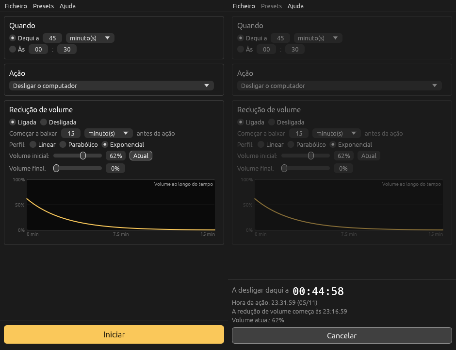

<p align="center">
  
</p>

<h1 align="center">Goodnight</h1>

<p align="center">
  <a href="https://github.com/pedrobaratafernandes/goodnight/actions/workflows/build.yml"></a>
  <a href="https://github.com/pedrobaratafernandes/goodnight/releases/latest"></a>
</p>

Temporizador para adormecer, para **Windows e Linux**, escrito em Rust.
Ao fim de um tempo (ou a uma hora marcada) desliga, suspende ou hiberna o computador e, antes disso, vai **baixando o volume aos poucos** para não acordar ninguém.



## Download

Os executáveis prontos a usar estão na página de [**Releases**](https://github.com/pedrobaratafernandes/goodnight/releases/latest):
- `goodnight-windows-x64.zip` → `goodnight.exe` (não precisa de instalação)
- `goodnight-linux-x64.tar.gz` → `goodnight`

Antes de descarregar, veja a [Code signing policy](#code-signing-policy).

**Desinstalar:** a app não tem instalador. Basta apagar o executável e, se quiser, a pasta de configuração (ver [Configuração](#configuração)).

É uma reimplementação de raiz do *Goodnight Timer 1.0* (freeware de 2006 para Windows), com as mesmas funcionalidades e algumas extra.

## Funcionalidades

| Original (2006)                                 | Esta versão                                                   |
|-------------------------------------------------|---------------------------------------------------------------|
| Timer em segundos / minutos / horas             | ✔                                                             |
| "At time" (a uma hora marcada)                  | ✔ (próxima ocorrência: hoje ou amanhã)                        |
| Ação: desligar / não desligar (só fechar)       | ✔ + **suspender** e **hibernar**                              |
| Redução de volume X tempo antes da ação         | ✔                                                             |
| Perfis linear / parabólico / exponencial        | ✔ com gráfico ao vivo                                         |
| Volume inicial e final                          | ✔ + botão "Atual" (lê o volume do sistema)                    |
| Presets (guardar / apagar)                      | ✔                                                             |
| Opção "forçar o fecho das aplicações"           | ✔                                                             |
| Opção "Enable sound at N%"                      | ✔ ("Repor o volume em N%" depois da ação)                     |
| Janela de estado + "Abort shutdown"             | ✔ (contagem, progresso da redução, volume atual, Cancelar)    |
| Ícone na bandeja do sistema                     | ✘ (fechar a janela pergunta se quer minimizar em vez disso)   |
| Envio de feedback / doações                     | removido                                                       |

Se cancelar a meio da redução, o volume volta ao valor inicial.

## Compilar

Precisa do Rust (https://rustup.rs). Depois, em qualquer um dos sistemas:

```sh
cargo build --release
```

O executável fica em `target/release/goodnight` (Linux) ou `target\release\goodnight.exe` (Windows). É um único ficheiro, sem instalador nem dependências.

No Windows, o ícone e a informação de versão são embutidos no `.exe` automaticamente (`build.rs`).

**GitHub Actions:** cada push compila e testa as versões Windows e Linux (`.github/workflows/build.yml`). Ao enviar uma tag `v*`, é criada uma Release com os executáveis anexados:

```sh
git tag -a v1.0.1 -m "Goodnight v1.0.1"
git push origin v1.0.1
```

## Requisitos em tempo de execução

**Windows** 7 ou superior. Volume via Core Audio; desligar/hibernar via `shutdown.exe`; suspender via `SetSuspendState`.

**Linux** (X11 ou Wayland, com OpenGL):
- Volume: usa o primeiro disponível de `wpctl` (PipeWire), `pactl` (PulseAudio) ou `amixer` (ALSA).
- Energia: `systemctl poweroff | suspend | hibernate` (funciona sem root na sessão ativa via polkit), com recurso a `loginctl` e `shutdown -h now`.
- "Forçar fecho" em Linux corresponde a `--ignore-inhibitors`.

## Configuração

Guardada automaticamente em JSON:
- Windows: `%APPDATA%\goodnight\config\config.json`
- Linux: `~/.config/goodnight/config.json`

## Testes

```sh
cargo test                      # perfis, presets, cálculo de horas, parsing do volume
cargo test -- --ignored e2e     # Linux: execução completa com wpctl/systemctl falsos
```

## Estrutura

```
src/main.rs            janela e ícone
src/ui.rs              interface (egui)
src/engine.rs          contagem, redução de volume e execução da ação (thread própria)
src/curve.rs           perfis linear / parabólico / exponencial
src/config.rs          definições, presets e gravação
src/system/linux.rs    volume e energia em Linux
src/system/windows.rs  volume e energia em Windows
build.rs               embute o ícone e a versão no .exe (Windows)
assets/icon.ico|png    ícone da aplicação
```

## Code signing policy

Free code signing provided by [SignPath.io](https://about.signpath.io/), certificate by [SignPath Foundation](https://signpath.org/).

> **Estado:** candidatura à SignPath Foundation em análise. Até ser aprovada, os executáveis Windows das releases **não estão assinados**. Assim que for aprovada, todas as releases seguintes passam a ser assinadas automaticamente pelo GitHub Actions, a partir deste repositório.

Só são assinados os executáveis compilados a partir do código deste repositório, pelo workflow [`build.yml`](.github/workflows/build.yml). Cada pedido de assinatura é aprovado manualmente.

**Papéis da equipa**

| Papel | Membros |
|---|---|
| Committers e revisores | [pedrobaratafernandes](https://github.com/pedrobaratafernandes) |
| Aprovadores | [pedrobaratafernandes](https://github.com/pedrobaratafernandes) |

**Privacidade**

This program will not transfer any information to other networked systems unless specifically requested by the user or the person installing or operating it.

O Goodnight não recolhe nem envia dados. A única coisa que grava é a configuração local, em JSON (ver [Configuração](#configuração)).
